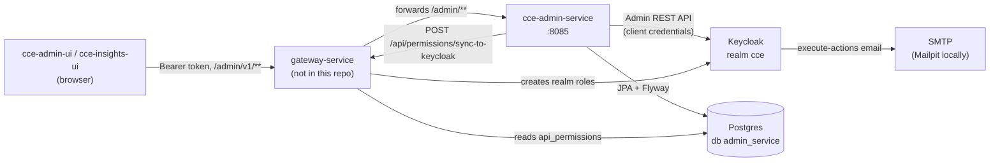
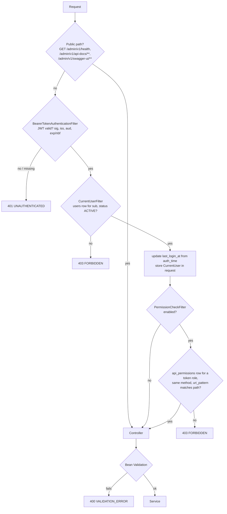

# Architecture overview

Source root: `../src/main/java/org/cce/admin/` (base package `org.cce.admin`). Entry point:
[`CceAdminServiceApplication.java`](../src/main/java/org/cce/admin/CceAdminServiceApplication.java)
(`@SpringBootApplication`, `@ConfigurationPropertiesScan`). Port 8085 by default.

## System context

Locally there is no gateway. Callers hit port 8085 directly, and `gateway-stub/` answers the sync
call (see [Local stack](#local-stack)).

## Packages

| Package | Main classes | Role |
|---|---|---|
| `controller` | `UserController`, `RoleController`, `MenuController`, `MeController`, `HealthController`, `ApiExceptionHandler`, `PageParams` | HTTP only. Each endpoint calls one service method. `ApiExceptionHandler` maps exceptions to the error envelope. |
| `controller.dto` | `UserDtos`, `RoleDtos`, `MenuDtos`, `MeDtos`, `CommonDtos` | Request/response records and Bean Validation rules. `CommonDtos` holds `ApiResponse`, `Pagination`, `Warning`, `ErrorBody`, `PartialStateDto`. |
| `service` | `UserService`, `AccountLinker`, `RoleService`, `RolePermissionService`, `RoleMenuService`, `MenuService`, `CurrentUserService`, `GatewaySyncService`, `BootstrapAdminRunner`, `HealthService` | Flows, transactions, locks, validation that needs the database, audit calls. |
| `service` (helpers) | `UserChangeLocks`, `UserViews`, `UserSearchSpecifications`, `MenuTreeBuilder`, `PermissionRowRules`, `ImplicitPermissions` | Locks, entity-to-DTO mapping, `GET /users` filters, `/me/menus` tree, permission row rules, the two implicit rows. |
| `service.exception` | `ApiException`, `ErrorCode`, `KeycloakSyncFailedException`, `PartialState` | Domain errors. `ErrorCode` carries the HTTP status. |
| `repository` | One Spring Data JPA repository per table | Queries, two pessimistic locks, bulk updates/deletes. |
| `entity` | `UserEntity`, `RoleEntity`, `MenuEntity`, `RoleMenuEntity`, `UserRoleEntity`, `AuditLogEntity`, `ApiPermissionEntity` + enums | JPA mappings of the seven tables. |
| `security` | `SecurityConfig`, `CurrentUserFilter`, `PermissionCheckFilter`, `RolesClaimReader`, `CurrentUser`, `SecurityErrorWriter` | The request pipeline below. |
| `client` | `KeycloakGateway` / `KeycloakAdminClientGateway`, `GatewaySyncClient` / `HttpGatewaySyncClient` | The only code that talks to Keycloak or the gateway. Interfaces are mocked in service tests. |
| `audit` | `AuditWriter`, `ActorProvider`, `AuditAction`, `AuditEntry` | The only code that inserts into `audit_log`. |
| `config` | `AdminProperties`, `KeycloakClientConfig`, `GatewayClientConfig`, `JacksonConfig`, `TrimmingStringDeserializer`, `OpenApiConfig` | Typed `admin.*` properties and client beans. |

## Request pipeline

Configured in [`SecurityConfig.java:46-72`](../src/main/java/org/cce/admin/security/SecurityConfig.java#L46-L72).
Stateless, CSRF off, no sessions.

1. **Public paths** skip token handling entirely. A custom `BearerTokenResolver` returns no token
   for them, so even a bad `Authorization` header is ignored
   ([`SecurityConfig.java:103-106`](../src/main/java/org/cce/admin/security/SecurityConfig.java#L103-L106)).
2. **JWT**: `NimbusJwtDecoder` with `admin.jwt.jwk-set-uri`, plus timestamp (30 s skew), issuer and
   audience validators ([`SecurityConfig.java:75-97`](../src/main/java/org/cce/admin/security/SecurityConfig.java#L75-L97)).
3. **Current user**: [`CurrentUserFilter`](../src/main/java/org/cce/admin/security/CurrentUserFilter.java),
   added after `BearerTokenAuthenticationFilter`.
4. **Permission check**: [`PermissionCheckFilter`](../src/main/java/org/cce/admin/security/PermissionCheckFilter.java),
   added after `CurrentUserFilter`.
5. **Controller**, with Bean Validation on bodies, path variables and query parameters.

Errors in steps 2 to 4 are written by `SecurityErrorWriter`, because controller advice does not
run inside filters. An unexpected exception inside either custom filter gives 500
`INTERNAL_ERROR`. Details are in [security-model.md](security-model.md).

Two input rules apply to every request body ([`JacksonConfig`](../src/main/java/org/cce/admin/config/JacksonConfig.java),
[`TrimmingStringDeserializer`](../src/main/java/org/cce/admin/config/TrimmingStringDeserializer.java),
`application.yml`): every JSON string is trimmed and an empty result becomes `null`, and an
unknown property fails (`spring.jackson.deserialization.fail-on-unknown-properties: true`). Query
and path strings are trimmed by a `StringTrimmerEditor` in `ApiExceptionHandler.initBinder`.

## External dependencies

| System | Client | How it is used |
|---|---|---|
| Postgres 16 | Spring Data JPA (Hibernate), HikariCP, Flyway | Six owned tables plus `api_permissions`. `ddl-auto: validate`, `open-in-view: false`. Connection wait at most 2 s (`hikari.connection-timeout: 2000`). Flyway history in `admin_service_flyway_history`. See [data-dictionary.md](data-dictionary.md). |
| Keycloak Admin REST API | `keycloak-admin-client` 26.0.12 via [`KeycloakClientConfig`](../src/main/java/org/cce/admin/config/KeycloakClientConfig.java) | Client-credentials grant of `KEYCLOAK_ADMIN_CLIENT_ID` against `KEYCLOAK_REALM`. RESTEasy client with pool size 10 and the configured connect/read timeouts. Used for user lookup/create/update, enable/disable, logout, realm role mappings, realm role lookups and execute-actions emails. All calls go through [`KeycloakAdminClientGateway`](../src/main/java/org/cce/admin/client/KeycloakAdminClientGateway.java). |
| Gateway sync endpoint | Spring `RestClient` on the JDK HTTP client ([`GatewayClientConfig`](../src/main/java/org/cce/admin/config/GatewayClientConfig.java), [`HttpGatewaySyncClient`](../src/main/java/org/cce/admin/client/HttpGatewaySyncClient.java)) | `POST {GATEWAY_BASE_URL}{GATEWAY_SYNC_PATH}`, no body, `Authorization: Bearer` with the service's own token taken from the Keycloak admin client's token manager (`serviceAccessToken` bean). Any 2xx is success. The response body is never parsed. |
| SMTP (Mailpit locally) | none | The service never talks SMTP. It asks Keycloak to send an execute-actions (`UPDATE_PASSWORD`) email; Keycloak sends it through the realm's SMTP settings (`mailpit:1025` in the local realm). |

Keycloak error mapping ([`KeycloakAdminClientGateway.java:214-249`](../src/main/java/org/cce/admin/client/KeycloakAdminClientGateway.java#L214-L249)):
a 404 on a lookup returns empty; a 409 raises `KeycloakConflictException`; anything else
(other status, timeout, connection error, token failure) raises `KeycloakCallFailedException`.
The gateway client never throws: every failure becomes `SyncResult(success=false, …)`.

Differs from the design (§5.1 step 5 and §7): `addRealmRoles` and `removeRealmRoles` first list
all realm roles, then add or remove, so each is two HTTP calls, not one
([`KeycloakAdminClientGateway.java:114-141`](../src/main/java/org/cce/admin/client/KeycloakAdminClientGateway.java#L114-L141)).
`toInfo` also makes one role-mapping call per user it returns.

## Transactions and locking

No service class or method is annotated `@Transactional`. Each database step runs in a
`TransactionTemplate`, so it commits before the next Keycloak or gateway call, except in the user
flows 5.2 to 5.4 below. Isolation is Postgres's default (read committed).

| Flow | Transaction scope | Locks |
|---|---|---|
| `POST /users` | Checks and Keycloak calls outside any transaction. One transaction for `users` + `user_roles` + `USER_CREATED` ([`AccountLinker.java:107-123`](../src/main/java/org/cce/admin/service/AccountLinker.java#L107-L123)). The email is sent after the commit. | none |
| `PUT /users/:id`, `PATCH /users/:id/status`, `PUT /users/:id/roles` | One transaction for the whole flow, **held open across the Keycloak calls** ([`UserService.java:585-599`](../src/main/java/org/cce/admin/service/UserService.java#L585-L599)). | `SELECT … FOR UPDATE` on the `users` row ([`UserChangeLocks.lockUser`](../src/main/java/org/cce/admin/service/UserChangeLocks.java#L30-L34)). When the change could remove the last active `SUPER_ADMIN`, also `FOR UPDATE` on the `SUPER_ADMIN` `roles` row before counting ([`requireAnotherActiveAdmin`](../src/main/java/org/cce/admin/service/UserChangeLocks.java#L42-L50)). |
| `POST /users/:id/reset-password` | Keycloak call, then one transaction for the audit row. | none |
| `POST /roles` | Checks outside a transaction; one transaction for role + implicit rows + `ROLE_CREATED`; then the gateway sync. | none |
| `PUT /roles/:id/permissions` | No-op check outside; one transaction for the rows + `ROLE_PERMISSIONS_UPDATED`; then the gateway sync. | none |
| Gateway sync (any) | Its own `REQUIRES_NEW` transaction for `sync_status`/`last_sync_at` + `ROLE_SYNC_REQUESTED` ([`GatewaySyncService.java:73-83`](../src/main/java/org/cce/admin/service/GatewaySyncService.java#L73-L83)). | none |
| `PUT /roles/:id`, `DELETE /roles/:id`, `PUT /roles/:id/menus`, menu CRUD | One transaction each, with its audit row. Delete-role Keycloak check runs before it. | none |
| Failure audit rows | `AuditWriter.recordInNewTransaction` (`REQUIRES_NEW`), so they survive the rollback of the flow. | none |
| `last_login_at` update | Its own transaction (`@Transactional` on [`UserRepository.updateLastLoginIfLater`](../src/main/java/org/cce/admin/repository/UserRepository.java#L41-L46)). | row update only |

There are no version columns or ETags: concurrent saves of the same role or menu are last write
wins.

Differs from the design ("How to use this plan" vs §5 "Locks"): the design says both "each
database step commits before the next Keycloak call" and "5.2 to 5.4 run inside one transaction
that holds the lock across the Keycloak calls". The code follows §5 for 5.2 to 5.4 (see the
`DESIGN-GAP` comment at [`UserService.java:57-62`](../src/main/java/org/cce/admin/service/UserService.java#L57-L62)).
A consequence: a pooled database connection is held while up to three Keycloak calls run (each
up to `KEYCLOAK_READ_TIMEOUT`, default 10 s).

Differs from the design (§8 "Writer"): the sync-result row is written with `record()` inside
`GatewaySyncService`'s own `REQUIRES_NEW` template, not with `recordInNewTransaction`. The effect
is that the `roles` update and the audit row commit together.

## Startup

1. Flyway runs `V1` to `V3` ([data-dictionary.md](data-dictionary.md)).
2. `AdminProperties` is validated: a blank required `admin.*` value stops startup with
   `set <VARIABLE>` ([`AdminProperties.java`](../src/main/java/org/cce/admin/config/AdminProperties.java)).
3. `PermissionCheckFilter` logs `PERMISSION_CHECK_ENABLED=<value>`, and a warning when it is off.
4. [`BootstrapAdminRunner`](../src/main/java/org/cce/admin/service/BootstrapAdminRunner.java)
   (an `ApplicationRunner`, not in profile `test`) links the first `SUPER_ADMIN` if none is
   active. It never throws; failures are logged at `ERROR`. See
   [flow-diagrams.md](flow-diagrams.md#bootstrap-of-the-first-super_admin).

## Configuration

All values are in [`application.yml`](../src/main/resources/application.yml). Outside profile
`test`, the service also imports `.env` from the working directory
(`spring.config.import: optional:file:.env[.properties]`).

| Property | Variable | Default | Notes |
|---|---|---|---|
| `server.port` | `SERVER_PORT` | `8085` | |
| `spring.datasource.url` / `username` / `password` | `DATABASE_URL`, `DATABASE_USERNAME`, `DATABASE_PASSWORD` | empty | Required in practice, but not checked by `AdminProperties`. |
| `admin.jwt.issuer` | `JWT_ISSUER` | none | Required. |
| `admin.jwt.audience` | `JWT_AUDIENCE` | none | Required. Token `aud` must contain it. |
| `admin.jwt.jwk-set-uri` | `JWT_JWK_SET_URI` | `${JWT_ISSUER}/protocol/openid-connect/certs` | |
| `admin.jwt.roles-claim-path` | `JWT_ROLES_CLAIM_PATH` | `realm_access.roles` | Dot path into the token claims. |
| `admin.keycloak.server-url` | `KEYCLOAK_SERVER_URL` | none | Required. |
| `admin.keycloak.realm` | `KEYCLOAK_REALM` | none | Required. |
| `admin.keycloak.client-id` | `KEYCLOAK_ADMIN_CLIENT_ID` | `cce-admin-service` | |
| `admin.keycloak.client-secret` | `KEYCLOAK_ADMIN_CLIENT_SECRET` | none | Required. |
| `admin.keycloak.connect-timeout` / `read-timeout` | `KEYCLOAK_CONNECT_TIMEOUT`, `KEYCLOAK_READ_TIMEOUT` | `2s`, `10s` | |
| `admin.keycloak.action-email-lifespan` | `KEYCLOAK_ACTION_EMAIL_LIFESPAN` | `43200` | Seconds. |
| `admin.keycloak.action-email-client-id` / `-redirect-uri` | `KEYCLOAK_ACTION_EMAIL_CLIENT_ID`, `KEYCLOAK_ACTION_EMAIL_REDIRECT_URI` | empty | Blank is sent as `null`. |
| `admin.gateway.base-url` | `GATEWAY_BASE_URL` | none | Required. |
| `admin.gateway.sync-path` | `GATEWAY_SYNC_PATH` | `/api/permissions/sync-to-keycloak` | |
| `admin.gateway.connect-timeout` / `read-timeout` | `GATEWAY_CONNECT_TIMEOUT`, `GATEWAY_READ_TIMEOUT` | `2s`, `10s` | |
| `admin.permission.check-enabled` | `PERMISSION_CHECK_ENABLED` | `true` | Turns `PermissionCheckFilter` off. |
| `server.tomcat.remoteip.internal-proxies` | `TRUSTED_PROXIES` | `(?!)` (matches nothing) | With `server.forward-headers-strategy: native`. Sets the audited client IP. |
| `admin.bootstrap.admin-username` | `BOOTSTRAP_ADMIN_USERNAME` | empty | Keycloak username to link as first `SUPER_ADMIN`. |
| `springdoc.api-docs.enabled` / `swagger-ui.enabled` | `SPRINGDOC_ENABLED` | `true` | Paths `/admin/v1/api-docs`, `/admin/v1/swagger-ui`. |

Differs from the design (§9.4, B-13) and from the repo README: a missing `DATABASE_*` variable
binds as an empty string and fails with the datasource's own error, which does not name the
variable. Only the `admin.*` values above fail with a `set <VARIABLE>` message.

## Local stack

[`docker-compose.yml`](../docker-compose.yml); every port is bound to `127.0.0.1`.

| Service | Image | Host port | Notes |
|---|---|---|---|
| `postgres` | `postgres:16.15-alpine` | 5433 | Databases `admin_service` and `keycloak` (created by `docker/postgres/init/01-create-keycloak-db.sql`), user `admin_service`. Volume `pgdata`. |
| `keycloak` | `quay.io/keycloak/keycloak:26.4.7` | 8180 | `start-dev --import-realm` of [`keycloak/realm-cce.json`](../keycloak/realm-cce.json), path `/auth`, `KC_HOSTNAME=http://localhost:8180/auth` so the issuer is the same from host and containers. Connects to Postgres as `admin_service`. |
| `mailpit` | `axllent/mailpit:v1.33.1` | 8025 | Catches Keycloak's emails (SMTP 1025 in-network). |
| `gateway-stub` | built from [`gateway-stub/`](../gateway-stub/) | 8090 | Stand-in for the gateway sync. |
| `admin-service` | built from [`Dockerfile`](../Dockerfile) | 8085 | Only with `--profile app`. Overrides `DATABASE_URL`, `KEYCLOAK_SERVER_URL`, `JWT_JWK_SET_URI`, `GATEWAY_BASE_URL` with in-network URLs. Image health check: `wget /admin/v1/health`. |

The realm import defines realm roles `SUPER_ADMIN` and `CCE_ADMIN_SERVICE`; clients
`cce-admin-ui` and `cce-insights-ui` (public, PKCE S256), `cce-admin-service` (confidential,
service account with `realm-management` `manage-users`, `view-users`, `query-users`,
`view-realm`, and realm role `CCE_ADMIN_SERVICE`), `cce-gateway-stub` (confidential,
`manage-realm`, `view-realm`) and `cce-e2e` (public, direct access grants). All but
`cce-gateway-stub` have an audience mapper adding `gateway-service`. Secrets and the test
administrator's username/password are `${…}` placeholders filled from `.env`.

Differs from the design (§9.2): the test administrator also holds `default-roles-cce`, not only
`SUPER_ADMIN`.

**gateway-stub** (Java `HttpServer`, [`GatewayStubMain.java`](../gateway-stub/src/main/java/org/cce/gatewaystub/GatewayStubMain.java)):

- `POST /api/permissions/sync-to-keycloak` ([`SyncHandler.java:40-68`](../gateway-stub/src/main/java/org/cce/gatewaystub/SyncHandler.java#L40-L68)):
  non-POST → 405; `fail` mode → 503; no `Bearer` header → 401 (the token is not validated);
  otherwise reads `SELECT DISTINCT permission_name FROM api_permissions`, creates a realm role
  tagged `cce-managed=true` for each name with no realm role, deletes tagged realm roles whose
  name has no rows (never built-in roles or `SUPER_ADMIN`), and returns 200
  `{"created":[…],"deleted":[…]}`. A database or Keycloak error gives 500.
- `GET /_stub/mode` returns `ok` or `fail`; `PUT /_stub/mode` with body `ok` or `fail` switches it
  (in memory, starts `ok`). Any other sub-path gives 404.

Differs from the design (§9.1): the 405, 500 and 404 responses are not in the design, and the
405 check comes before fail mode.

## Tests

| Layer | Where | Notes |
|---|---|---|
| Unit / service | `src/test/java/org/cce/admin/service`, `audit`, `client`, `config` | Service tests use Testcontainers Postgres and Mockito mocks of `KeycloakGateway` and `GatewaySyncClient`. |
| Web | `controller/*WebTest`, `security/*WebTest` | MockMvc with a test JWT decoder that applies the real validators. |
| Migration | `migration/*Test` | Empty database, pre-existing gateway table, wrong shape. |
| E2E | `e2e/*E2E.java`, `./mvnw -Pe2e verify` | Against the running compose stack (scenarios S1 to S6). |
