# Flow diagrams

The main write flows, as implemented. Step names in `CAPITALS` are the values used in a 502's
`partialState.failedStep` / `completedSteps`. Common rules:

- **No compensation.** A Keycloak step is never undone after a later step fails. Recovery is to
  submit the same request again: every Keycloak step sets a target state, so repeating it is safe.
  The service itself never retries.
- **Keycloak failures before anything changed** give 502 `KEYCLOAK_SYNC_FAILED` with
  `completedSteps: []` and no audit row.
- **Audit rows** follow the rules in [Audit writing](#audit-writing).

Class shorthand: `UserService` = [`service/UserService.java`](../src/main/java/org/cce/admin/service/UserService.java),
`AccountLinker` = [`service/AccountLinker.java`](../src/main/java/org/cce/admin/service/AccountLinker.java),
`RoleService` = [`service/RoleService.java`](../src/main/java/org/cce/admin/service/RoleService.java),
`RolePermissionService` = [`service/RolePermissionService.java`](../src/main/java/org/cce/admin/service/RolePermissionService.java),
`GatewaySyncService` = [`service/GatewaySyncService.java`](../src/main/java/org/cce/admin/service/GatewaySyncService.java).

## Create user

`POST /admin/v1/users`, operation `USER_CREATE`
([`UserService.create`, lines 153-229](../src/main/java/org/cce/admin/service/UserService.java#L153-L229);
steps 5 and 6 in [`AccountLinker.link`, lines 90-124](../src/main/java/org/cce/admin/service/AccountLinker.java#L90-L124)).

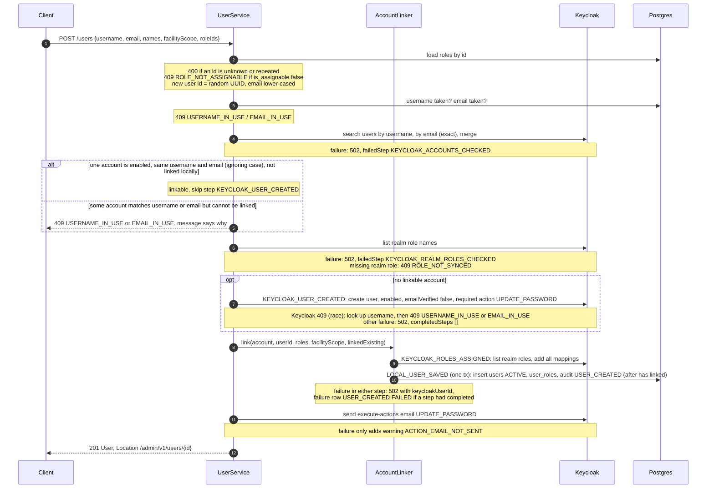

Notes:

- **Linking.** If the 502 came after `KEYCLOAK_USER_CREATED`, the Keycloak account exists with no
  local row. Resubmitting the same request finds it, links it, and completes. A linked account's
  local first and last names come from the request; Keycloak's names are left unchanged (a
  `DESIGN-GAP` choice, [`UserService.java:191-196`](../src/main/java/org/cce/admin/service/UserService.java#L191-L196)).
- **The email** is sent by Keycloak through the realm's SMTP server (Mailpit locally), with lifespan
  `KEYCLOAK_ACTION_EMAIL_LIFESPAN` and the optional client id and redirect URI.

Differs from the design (§5.1 step 3, §7 "exactly this username and this email"): the linking
match uses `equalsIgnoreCase` for both fields
([`UserService.java:177-183`](../src/main/java/org/cce/admin/service/UserService.java#L177-L183)).
Differs from the design (§5.1 step 5 "in one call"): `addRealmRoles` lists the realm roles first,
so it is two Keycloak calls.

## User flows that hold a lock (profile, status, roles)

`PUT /users/{id}`, `PATCH /users/{id}/status` and `PUT /users/{id}/roles` share one pattern
([`UserService.run` and `Flow`, lines 585-671](../src/main/java/org/cce/admin/service/UserService.java#L585-L671)):

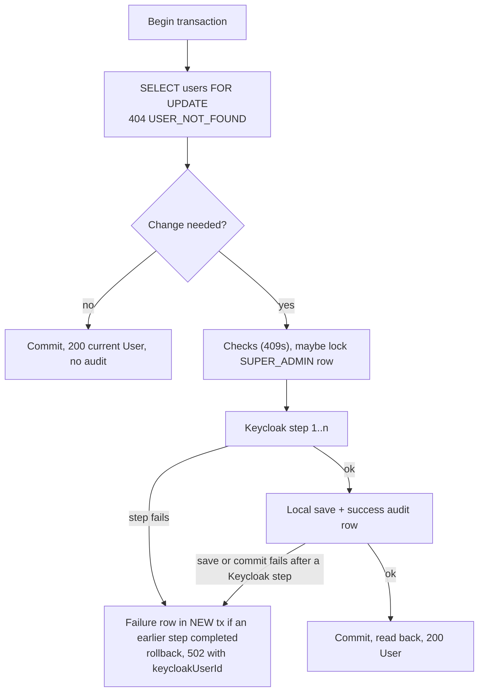

The `users` row lock is held while Keycloak is called, so two requests for the same user run one
after the other.

### Update profile

`PUT /users/{id}`, `USER_PROFILE_UPDATE` ([lines 283-332](../src/main/java/org/cce/admin/service/UserService.java#L283-L332)).

1. Lock the user. A changed email (lower-cased) must not belong to another user: 409 `EMAIL_IN_USE`.
2. No-op when email, names and `facilityScope` are all unchanged.
3. `KEYCLOAK_PROFILE_UPDATED`, only when email or a name changed. If the email is unchanged, the
   current `emailVerified` is read from Keycloak first and kept; a changed email sets it `false`.
   A Keycloak 409 gives 409 `EMAIL_IN_USE`.
4. `LOCAL_PROFILE_SAVED`: update the row, audit `USER_UPDATED` (User / User).

A change to `facilityScope` alone makes no Keycloak call.

### Status change

`PATCH /users/{id}/status`, `USER_STATUS_CHANGE`
([lines 348-396](../src/main/java/org/cce/admin/service/UserService.java#L348-L396)).

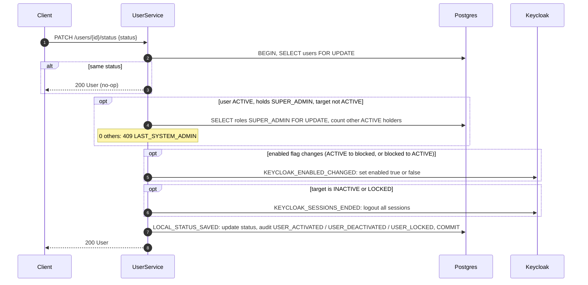

`user_roles` is never touched. `INACTIVE` ↔ `LOCKED` skips `KEYCLOAK_ENABLED_CHANGED` but still
ends sessions. A blocked user's next request gets 403 from `CurrentUserFilter`, even with a token
that is still valid.

### Change user roles

`PUT /users/{id}/roles`, `USER_ROLES_UPDATE`
([lines 401-463](../src/main/java/org/cce/admin/service/UserService.java#L401-L463)).

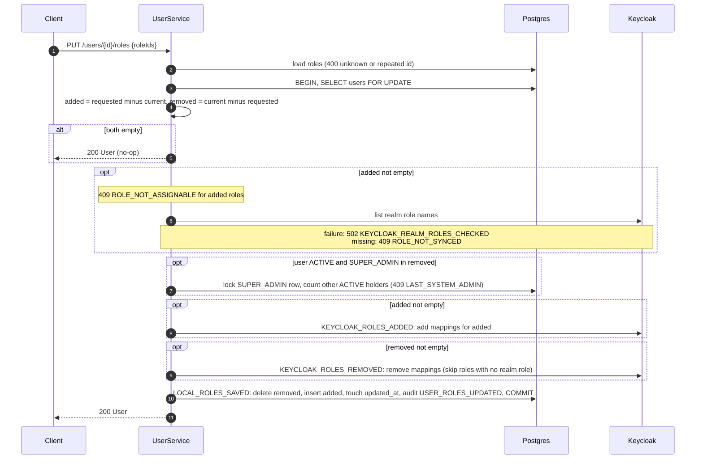

Only changed mappings move in Keycloak. Mappings the user holds in Keycloak but not locally are
left alone.

## Password reset email

`POST /users/{id}/reset-password`, `USER_PASSWORD_RESET`
([lines 468-487](../src/main/java/org/cce/admin/service/UserService.java#L468-L487)).

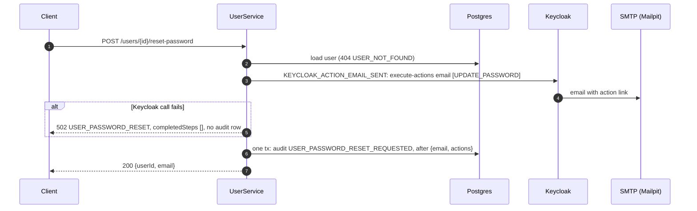

Allowed for any status. No lock is taken and no password passes through the service.

## Create, update and delete role

### Create role

`POST /admin/v1/roles` ([`RoleService.create`, lines 111-168](../src/main/java/org/cce/admin/service/RoleService.java#L111-L168)).

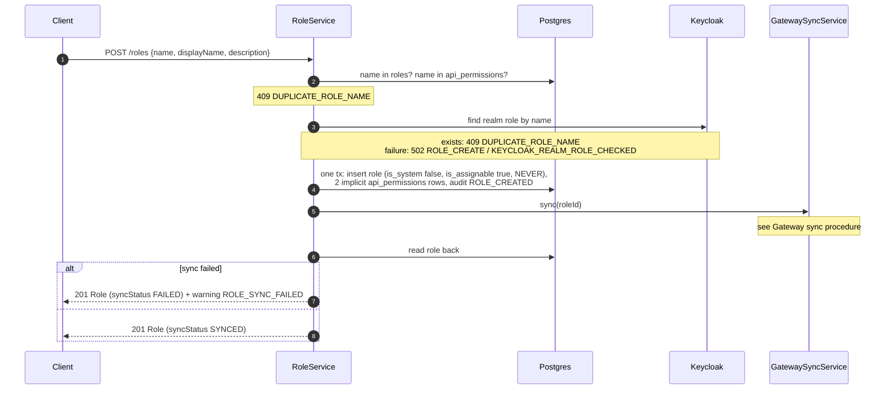

A successful create writes two audit rows: `ROLE_CREATED` and `ROLE_SYNC_REQUESTED`. The new role
cannot be assigned to users until its realm role exists (409 `ROLE_NOT_SYNCED`).

On the 502 path, `RoleService` drops the Keycloak exception: it is neither logged nor attached
([lines 125-129](../src/main/java/org/cce/admin/service/RoleService.java#L125-L129)), unlike
`UserService`, which logs it.

### Update role

`PUT /roles/{id}` ([lines 171-189](../src/main/java/org/cce/admin/service/RoleService.java#L171-L189)):
one transaction; 409 `SYSTEM_ROLE_IMMUTABLE` for system roles; no-op if `displayName` and
`description` are unchanged; else save and audit `ROLE_UPDATED`. No Keycloak or gateway call.

### Delete role

`DELETE /roles/{id}` ([lines 192-231](../src/main/java/org/cce/admin/service/RoleService.java#L192-L231)).

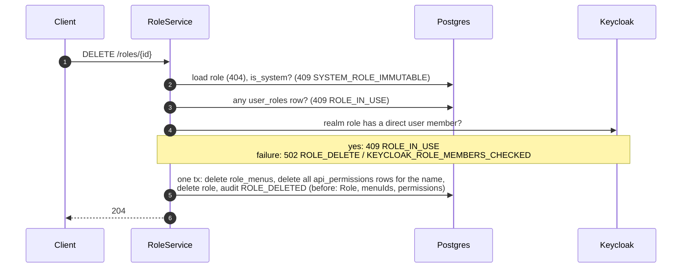

No gateway sync runs, so the realm role stays in Keycloak. Its name cannot be reused (the realm
role check in create fails) until a later sync lets the gateway delete it. With the local stub,
any later sync deletes realm roles it tagged `cce-managed` whose name has no rows.

## Change role permissions and gateway sync

`PUT /roles/{id}/permissions`, `ROLE_PERMISSIONS_SAVE`
([`RolePermissionService.replace`, lines 71-123](../src/main/java/org/cce/admin/service/RolePermissionService.java#L71-L123)).

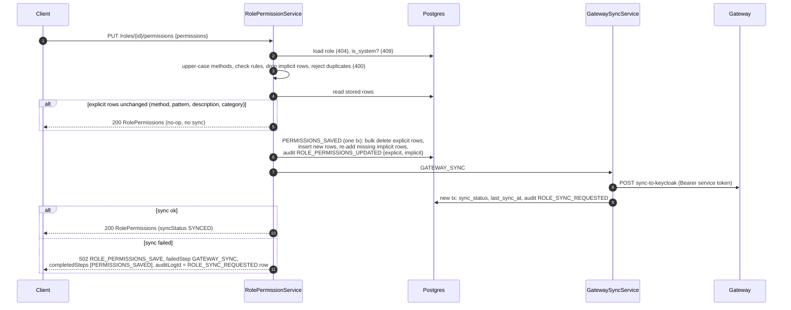

On a sync failure the rows stay saved and `syncStatus` is `FAILED`. The 502 body does not contain
the rows; call `GET /roles/{id}/permissions` to show them. To recover, call
`POST /roles/{id}/sync` (re-sync):

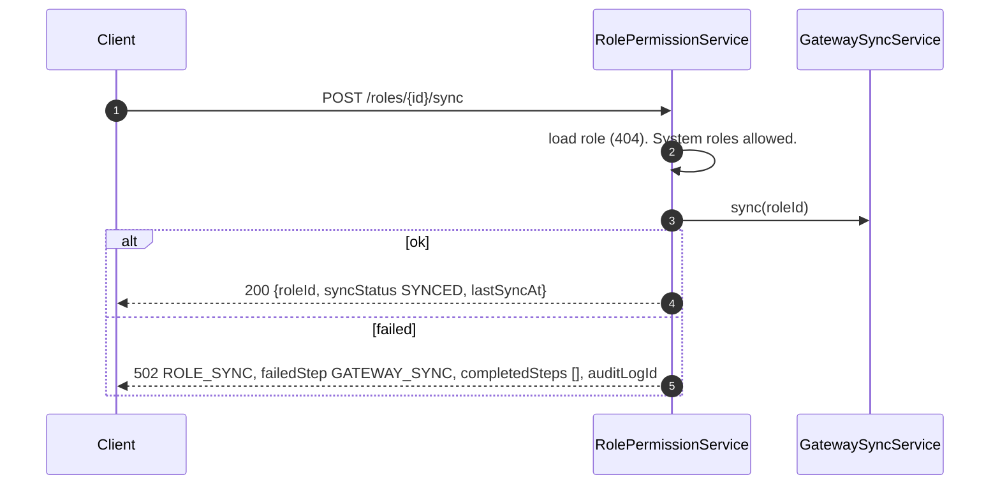

### Gateway sync procedure

[`GatewaySyncService.sync`, lines 65-89](../src/main/java/org/cce/admin/service/GatewaySyncService.java#L65-L89)
and [`HttpGatewaySyncClient.sync`, lines 42-62](../src/main/java/org/cce/admin/client/HttpGatewaySyncClient.java#L42-L62).
Used by role create, permission save and re-sync. It never throws.

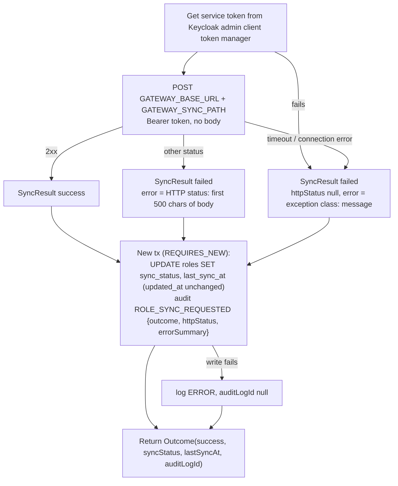

The gateway sync is a full sync of every `permission_name`, but `sync_status` is updated only on
the role that asked. Other roles' `syncStatus` can therefore be stale.

## Menus and `/me/menus`

### Replace a role's menus

`PUT /roles/{id}/menus` ([`RoleMenuService.replace`, lines 68-123](../src/main/java/org/cce/admin/service/RoleMenuService.java#L68-L123)).

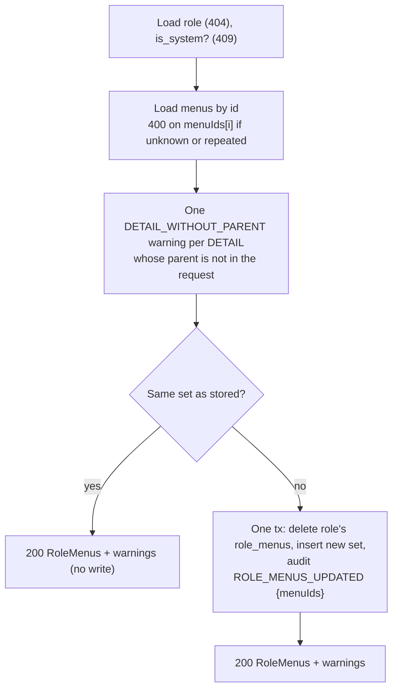

### Menu catalog

`POST`, `PUT` and `DELETE /menus` ([`MenuService`](../src/main/java/org/cce/admin/service/MenuService.java))
are each one transaction with one audit row (`MENU_CREATED`, `MENU_UPDATED`, `MENU_DELETED`). No
Keycloak or gateway call. Create checks the parent rule and the key; update checks the parent
rule against the stored `type` and is a no-op when nothing changed; delete refuses a menu with
children (409 `MENU_HAS_CHILDREN`), then deletes its `role_menus` rows and the menu, with the role
ids in the audit `before`.

### Build `/me/menus`

`GET /me/menus` ([`CurrentUserService.menus`](../src/main/java/org/cce/admin/service/CurrentUserService.java#L49-L55),
[`MenuTreeBuilder`](../src/main/java/org/cce/admin/service/MenuTreeBuilder.java),
[`MenuRepository.findActiveGrantedToRoleNames`](../src/main/java/org/cce/admin/repository/MenuRepository.java#L17-L19)).

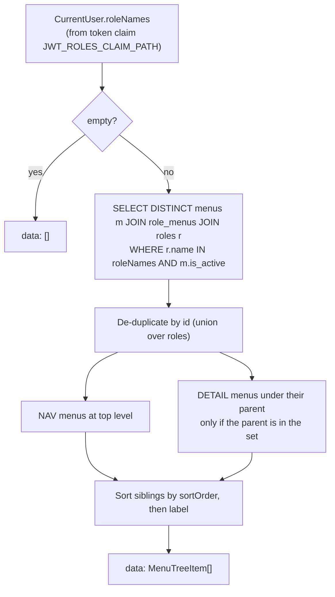

Roles come from the token, not from `user_roles`. A `DETAIL` granted without its parent, or whose
parent is inactive, is left out.

## Audit writing

[`AuditWriter`](../src/main/java/org/cce/admin/audit/AuditWriter.java) is the only writer.
`record()` requires an existing transaction (`Propagation.MANDATORY`);
`recordInNewTransaction()` uses `REQUIRES_NEW`. Each row gets the actor from
[`ActorProvider`](../src/main/java/org/cce/admin/audit/ActorProvider.java) and the IP from the
current request.

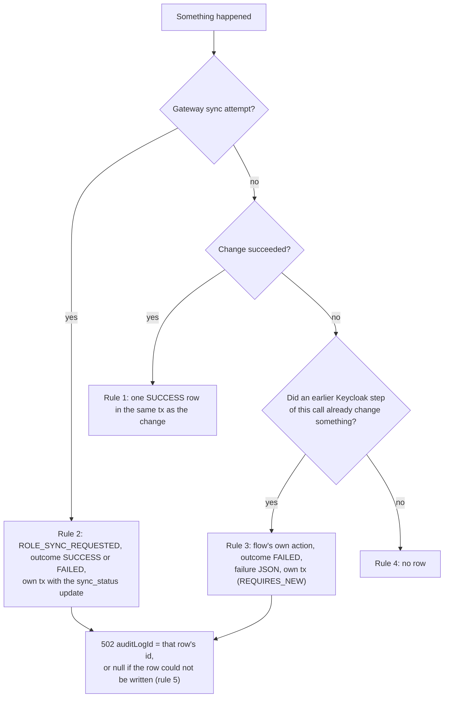

No-ops write nothing. `POST /roles` and a changed `PUT /roles/{id}/permissions` write two rows
each; `POST /roles/{id}/sync` writes one.

## Bootstrap of the first SUPER_ADMIN

[`BootstrapAdminRunner.bootstrap`, lines 66-116](../src/main/java/org/cce/admin/service/BootstrapAdminRunner.java#L66-L116),
at every startup outside profile `test`. Every failure is logged at `ERROR`; startup continues.

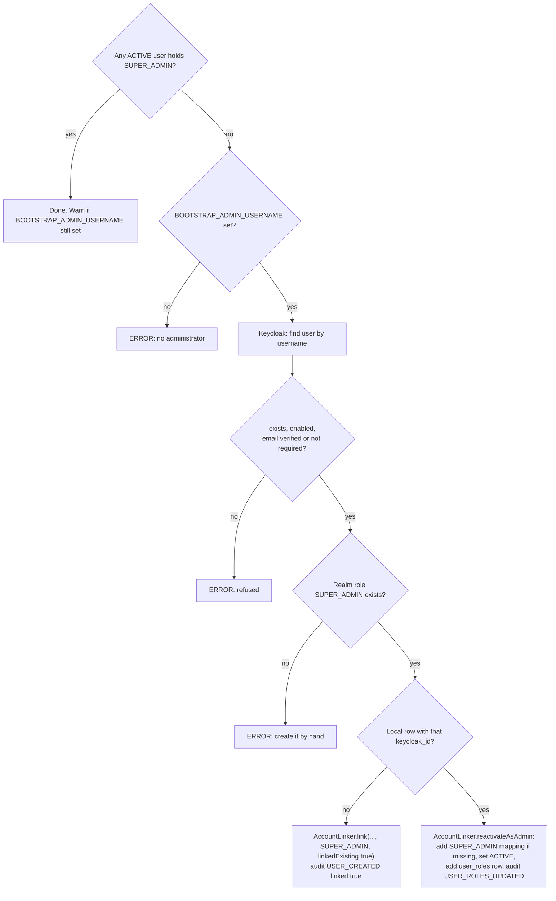

The actor of these rows is `system:bootstrap`. The bootstrapper never runs a gateway sync.
