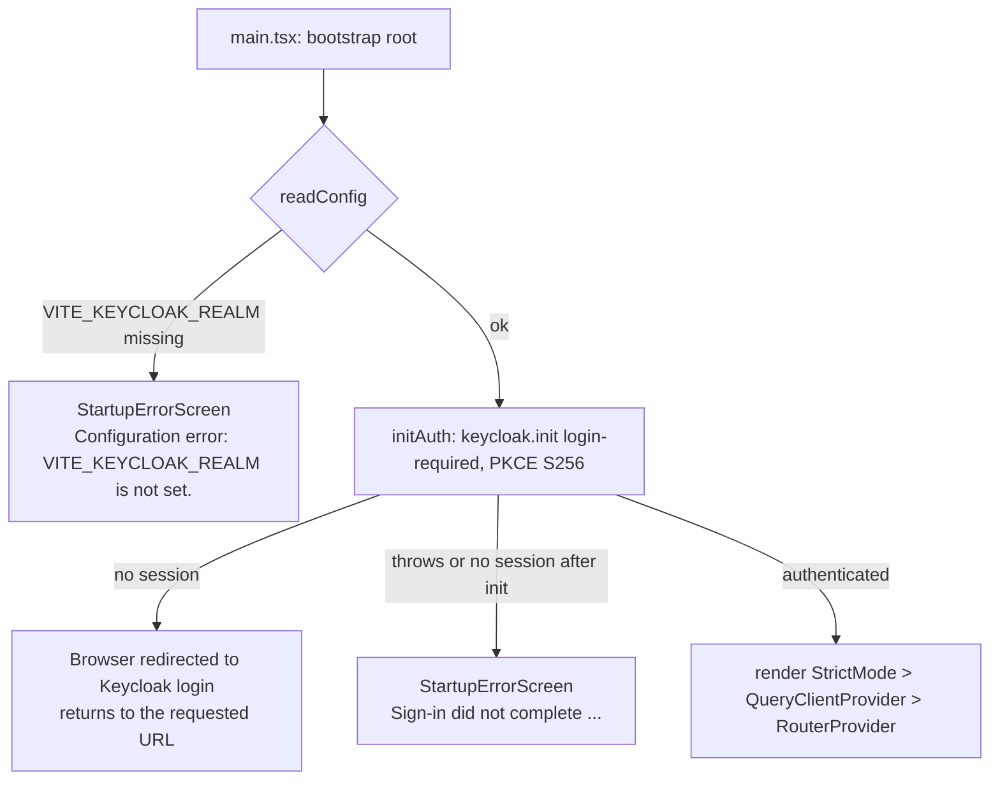
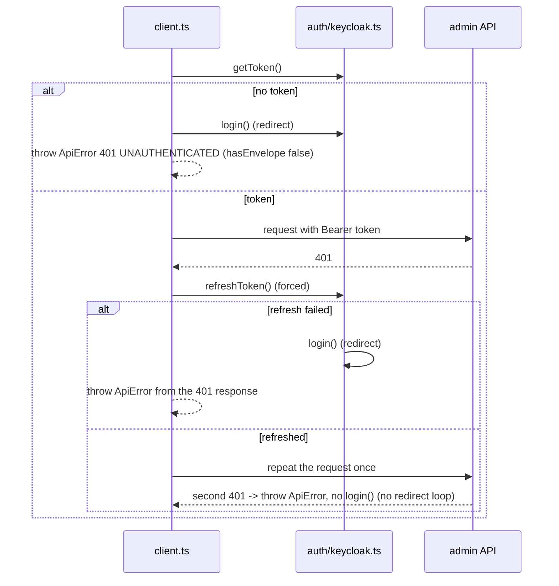

# Architecture overview

## Stack and versions

All versions are pinned exactly in [`package.json`](../package.json). Node must be
`>=20.19.0 <23` (`engines`). The Docker build uses `node:20.20.2-alpine`.

| Area            | Package                                                                   | Version                          |
| --------------- | ------------------------------------------------------------------------- | -------------------------------- |
| UI              | `react`, `react-dom`                                                      | 18.3.1                           |
| Routing         | `react-router` (data router)                                              | 7.18.5                           |
| Server state    | `@tanstack/react-query`                                                   | 5.107.1                          |
| Tables          | `@tanstack/react-table`                                                   | 8.21.3                           |
| Forms           | `react-hook-form` / `@hookform/resolvers` / `zod`                         | 7.91.0 / 3.10.0 / 3.25.76        |
| Auth            | `keycloak-js`                                                             | 26.2.5                           |
| Icons           | `@heroicons/react`                                                        | 2.2.0                            |
| Dates           | `date-fns`                                                                | 4.4.0                            |
| Build           | `vite` / `@vitejs/plugin-react` / `typescript`                            | 6.4.6 / 4.7.0 / 5.9.3            |
| Styling         | `tailwindcss` / `@tailwindcss/vite`                                       | 4.3.5                            |
| Unit tests      | `vitest` / `@vitest/coverage-v8` / `jsdom`                                | 3.2.7 / 3.2.7 / 26.1.0           |
| Component tests | `@testing-library/react` / `user-event` / `jest-dom`                      | 16.3.3 / 14.6.9 / 6.10.0         |
| API mocks       | `msw`                                                                     | 2.15.0                           |
| Browser tests   | `@playwright/test`                                                        | 1.65.0                           |
| Lint / format   | `eslint` / `typescript-eslint` / `eslint-plugin-react-hooks` / `prettier` | 9.39.5 / 8.72.2 / 5.2.0 / 3.9.10 |

TypeScript runs in `strict` mode with `noUncheckedIndexedAccess` and `verbatimModuleSyntax`
([`tsconfig.app.json`](../tsconfig.app.json)). Tailwind is loaded with a single
`@import 'tailwindcss';` in [`src/index.css`](../src/index.css). There is no component library.

## Folder layout

```text
cce-admin-ui/
├── index.html, vite.config.ts, vitest.config.ts, playwright.config.ts, eslint.config.js
├── Dockerfile, Caddyfile, .env.example
├── e2e/                      Playwright tests (CUJ 2 to CUJ 6), auth setup, fixtures
└── src/
    ├── main.tsx              calls bootstrap(#root)
    ├── bootstrap.tsx         config check -> sign-in -> render
    ├── config.ts             the only reader of import.meta.env
    ├── routes.tsx            route objects (shared by app and tests)
    ├── auth/                 keycloak.ts (keycloak-js wrapper), useAuth.ts
    ├── api/                  client.ts, ApiError.ts, contract.ts, results.ts, one module per resource
    ├── hooks/                queryClient, queryKeys, one TanStack Query hook per api function, URL/paging helpers
    ├── schemas/              Zod schemas per form; rules.ts holds the field-rule constants
    ├── utils/                describeError, formErrors, format, menuTree, permissions (pure functions)
    ├── components/           layout/, shared/, users/, roles/, menus/ (props in, callbacks out)
    ├── pages/                route components, plus role-detail/ tabs, StartupErrorScreen
    └── test/                 Vitest setup, fakeAuth, render helpers, MSW handlers and fixtures
```

Unit and component tests sit next to the code in `__tests__/` folders. The
`__lint_fixtures__/` folders hold files that deliberately break the import rules. ESLint ignores
them in normal runs, and [`src/test/__tests__/lintRules.test.ts`](../src/test/__tests__/lintRules.test.ts)
lints them to prove that each rule fires.

## Layers and import rules

```text
pages/  ──▶ hooks/ ──▶ api/<resource>.ts ──▶ api/client.ts ──▶ fetch
  │           │                                   │
  │           └──▶ utils/, schemas/               └──▶ auth/keycloak.ts (getToken, refreshToken, login)
  └──▶ components/ ──▶ utils/, schemas/, (types from api/contract)
```

- **pages/** are route components. They call hooks, build `DescribedError`s, and pass data and
  callbacks to components.
- **components/** only render. Data and callbacks arrive as props.
- **hooks/** has one `useQuery` or `useMutation` per `api/` function.
- **api/** has one plain async function per endpoint. It has no React code.
  [`client.ts`](../src/api/client.ts) is the only module that calls `fetch`.

[`eslint.config.js`](../eslint.config.js) enforces these rules with
`@typescript-eslint/no-restricted-imports`. There are five file groups:

| Files                                                                   | May not import                                                                                                                                                                  |
| ----------------------------------------------------------------------- | ------------------------------------------------------------------------------------------------------------------------------------------------------------------------------- |
| `src/components/**`                                                     | `@tanstack/react-query`; `src/hooks/*`; any `src/api/*` module except `api/contract`, and from `api/contract` only with `import type`; `keycloak-js`; `msw`; `@playwright/test` |
| `src/pages/**`                                                          | any `src/api/*` module except type-only imports from `api/contract`; `keycloak-js`; `msw`; `@playwright/test`                                                                   |
| `src/auth/**`                                                           | `msw`; `@playwright/test`                                                                                                                                                       |
| all other `src/**`                                                      | `keycloak-js`; `msw`; `@playwright/test`                                                                                                                                        |
| tests (`*.test.ts(x)`, `src/test/**`), `e2e/**`, `playwright.config.ts` | no restriction                                                                                                                                                                  |

Runtime constants that pages and components need from the contract (`USER_STATUSES`,
`PERMISSION_METHODS`) are re-exported from [`src/schemas/rules.ts`](../src/schemas/rules.ts).

The base config also turns on `recommendedTypeChecked`, `react-hooks` `recommended-latest`,
`no-floating-promises` (unawaited promises must use `void`) and `no-misused-promises`, with
`onSubmit={handleSubmit(fn)}` allowed.

Two more rules are checked by tests, not by ESLint.
[`src/__tests__/configSource.test.ts`](../src/__tests__/configSource.test.ts) checks that only
`src/config.ts` reads `import.meta.env`, and only the four `VITE_*` variables. Code review has to
catch the rest, for example a lower layer importing a higher one, or a `fetch` outside
`client.ts`.

## Start-up and routing



- [`src/bootstrap.tsx`](../src/bootstrap.tsx) renders nothing until `initAuth()` resolves. No
  flag or static token can skip sign-in. The start-up screen is not a route and makes no API
  call.
- [`src/routes.tsx`](../src/routes.tsx) holds one layout route (`AppLayout`) with seven child
  routes and a `*` catch-all. The app uses `createBrowserRouter`. Tests build a
  `createMemoryRouter` from the same objects. A data router is needed for `useBlocker` (the
  unsaved-changes guard). Pages are not lazy-loaded.
- The sidebar is static: Users, Roles and Menus, whatever the caller's roles. The header shows
  the username and role names from `GET /me`, plus Sign out. See
  [pages-and-wireframes.md](pages-and-wireframes.md) for the route table.

## Auth

All `keycloak-js` use is in [`src/auth/keycloak.ts`](../src/auth/keycloak.ts).

| Function           | What it does                                                                                                                                                                                                                                                                                                                                                                                         |
| ------------------ | ---------------------------------------------------------------------------------------------------------------------------------------------------------------------------------------------------------------------------------------------------------------------------------------------------------------------------------------------------------------------------------------------------- |
| `initAuth(config)` | Creates `new Keycloak({ url, realm, clientId })` and calls `init({ onLoad: 'login-required', pkceMethod: 'S256', checkLoginIframe: false })`. Rejects if `init` throws or resolves unauthenticated. Then starts a 60-second interval that calls `updateToken(70)`, so the token is refreshed once it has less than 70 s left. A failed interval refresh is ignored and tried again on the next tick. |
| `getToken()`       | Returns `keycloak.token`. The token lives only in memory, never in `localStorage`, `sessionStorage` or a cookie.                                                                                                                                                                                                                                                                                     |
| `refreshToken()`   | Forces a refresh with `updateToken(-1)`. On failure it calls `login()` (a redirect to Keycloak) and returns `false`.                                                                                                                                                                                                                                                                                 |
| `login()`          | `keycloak.login()`.                                                                                                                                                                                                                                                                                                                                                                                  |
| `logout()`         | Clears the refresh interval, then `keycloak.logout({ redirectUri: window.location.origin + '/' })`.                                                                                                                                                                                                                                                                                                  |

[`src/auth/useAuth.ts`](../src/auth/useAuth.ts) exposes `logout` to `AppLayout`, which passes it
to `Header` as `onSignOut`.

Differs from the design: clearing the refresh interval in `logout()` is not in the design (item
25). It is harmless.

### 401 handling in the client



Differs from the design: the design (API client section) says a missing token throws "a 401
`ApiError`" without naming a code. The code uses `UNAUTHENTICATED`.

## API client and contract

- [`src/api/contract.ts`](../src/api/contract.ts) is a hand-written mirror of the admin-service
  contract (envelopes, error codes, resources, request bodies). Nothing generates it from the
  service, so a change in the service must be copied here by hand.
- [`src/api/client.ts`](../src/api/client.ts):
  - `apiRequest<T>(method, path, { query, body, signal })` builds
    `${VITE_API_BASE_URL}/admin/v1${path}`. It drops query values that are `undefined`, `null`
    or `''`, sends `Authorization`, `Accept: application/json`, and `Content-Type` only when there
    is a body. It returns the `{ data, pagination?, warnings? }` envelope.
  - `apiDelete(path)` is used only for `DELETE /roles/:id`, which answers 204. Any 2xx counts as
    success.
  - Errors become [`ApiError`](../src/api/ApiError.ts) (`status`, `code`, `message`, `details?`,
    `partialState?`, `hasEnvelope`). A non-envelope error body gets
    `CLIENT_UNEXPECTED_RESPONSE`. A failed `fetch` gets status 0 and `CLIENT_NETWORK_ERROR`. A
    2xx without `data` also gets `CLIENT_UNEXPECTED_RESPONSE`.
- Resource modules ([`users.ts`](../src/api/users.ts), [`roles.ts`](../src/api/roles.ts),
  [`roleMenus.ts`](../src/api/roleMenus.ts), [`rolePermissions.ts`](../src/api/rolePermissions.ts),
  [`menus.ts`](../src/api/menus.ts), [`me.ts`](../src/api/me.ts)) unwrap `data`. They return
  `Page<T>` for lists and `WithWarnings<T>` where the endpoint can send warnings
  ([`results.ts`](../src/api/results.ts)). Path ids go through `encodeURIComponent`.
- A paginated list without its `pagination` block is treated as `CLIENT_UNEXPECTED_RESPONSE`
  (a choice the code made where the design is silent).

The full endpoint list is in [api-integration.md](api-integration.md).

## Query layer

[`src/hooks/queryClient.ts`](../src/hooks/queryClient.ts) creates the `QueryClient`:

| Setting                | Value                                                                                                                                                                                                                                                         |
| ---------------------- | ------------------------------------------------------------------------------------------------------------------------------------------------------------------------------------------------------------------------------------------------------------- |
| `staleTime`            | 30 s                                                                                                                                                                                                                                                          |
| `refetchOnWindowFocus` | off                                                                                                                                                                                                                                                           |
| Query retry            | once, only when `ApiError.status` is 0 or 500 or above (tests pass `retry: false`)                                                                                                                                                                            |
| Mutation retry         | 0                                                                                                                                                                                                                                                             |
| Refetch rule           | A `MutationCache.onSettled` calls `queryClient.invalidateQueries()` (all active queries) after a successful mutation, or after an error whose kind is `syncFailed`, `network` or `unexpected`. After a 4xx with the service's envelope, nothing is refetched. |

Mutations never write to the cache before the server answers. There are no optimistic updates
and no `setQueryData`. Fresh data always comes from the refetch rule.

Query keys ([`queryKeys.ts`](../src/hooks/queryKeys.ts)):

| Key                                     | Hook                                                                  |
| --------------------------------------- | --------------------------------------------------------------------- |
| `['me']`                                | `useMe`                                                               |
| `['users', 'list', query]`              | `useUserList` (with `placeholderData: keepPreviousData`)              |
| `['users', 'detail', id]`               | `useUser`                                                             |
| `['roles', 'list', { page, pageSize }]` | `useRoleList`                                                         |
| `['roles', 'all']`                      | `useAllRoles` (up to 5 pages of 100; `truncated` when there are more) |
| `['roles', 'detail', id]`               | `useRole`                                                             |
| `['roles', id, 'menus']`                | `useRoleMenus`                                                        |
| `['roles', id, 'permissions']`          | `useRolePermissions`                                                  |
| `['menus', 'tree']`                     | `useMenuTree`                                                         |

Other hooks: `usePagingParams` (reads `page` and `pageSize` from the URL and replaces invalid
values with 1 and 20), `useDebouncedValue` (300 ms for the Users text filters), and
`useUnsavedChangesGuard` (wraps `useBlocker`).

## Error presentation

[`describeError(error, { detailFetch? })`](../src/utils/describeError.ts) maps any thrown value
to a `DescribedError` with a `kind`. Screens choose what to render from `kind` and `code`, and
never parse `message`.

| Kind              | Rule (checked in this order)                                                                                                                                                                               | Shown by                                                                                                                                                                                     |
| ----------------- | ---------------------------------------------------------------------------------------------------------------------------------------------------------------------------------------------------------- | -------------------------------------------------------------------------------------------------------------------------------------------------------------------------------------------- |
| `forbidden`       | code `FORBIDDEN`, or HTTP 403 without the envelope                                                                                                                                                         | `InlineError`: "You do not have permission to do this." plus the server message                                                                                                              |
| `syncFailed`      | code `KEYCLOAK_SYNC_FAILED`                                                                                                                                                                                | `SyncFailedNotice` (when `partialState` is present)                                                                                                                                          |
| `validation`      | code `VALIDATION_ERROR`; with `detailFetch`, a single detail on field `id` becomes `notFound`                                                                                                              | field messages, the rest in `FormErrorSummary`                                                                                                                                               |
| `conflict`        | `EMAIL_IN_USE`, `USERNAME_IN_USE`, `DUPLICATE_ROLE_NAME`, `DUPLICATE_MENU_KEY`, `ROLE_IN_USE`, `SYSTEM_ROLE_IMMUTABLE`, `LAST_SYSTEM_ADMIN`, `ROLE_NOT_ASSIGNABLE`, `ROLE_NOT_SYNCED`, `MENU_HAS_CHILDREN` | a mapped field, the role-checkbox messages, or the server message next to the action                                                                                                         |
| `notFound`        | `USER_NOT_FOUND`, `ROLE_NOT_FOUND`, `MENU_NOT_FOUND`                                                                                                                                                       | `NotFoundPanel` on detail pages, otherwise the server message                                                                                                                                |
| `unauthenticated` | HTTP 401 (after the client's refresh-and-repeat)                                                                                                                                                           | `InlineError`: "The admin service did not accept your sign-in. Sign out and sign in again."                                                                                                  |
| `network`         | `CLIENT_NETWORK_ERROR`                                                                                                                                                                                     | `InlineError`: "Cannot reach the admin service."                                                                                                                                             |
| `unexpected`      | anything else, and any non-`ApiError` value                                                                                                                                                                | `InlineError`: "Something went wrong (HTTP {status}, {code})." For `NOT_FOUND` and `METHOD_NOT_ALLOWED`: "The console and the admin service disagree about the API (HTTP {status}, {code})." |

The display components are in [`src/components/shared/`](../src/components/shared/):

- `InlineError`: the fixed text for the kind, the server message (for `forbidden`, and alone for
  kinds without a fixed text), an optional Retry button, and, for mutations with `network` or
  `unexpected`, "The result is unknown; the page was refreshed."
- `SyncFailedNotice`: the 502 notice. See [api-integration.md](api-integration.md#sync-failures-502-keycloak_sync_failed).
- `NotFoundPanel`, `FormErrorSummary`, `WarningList`, `SuccessNotice`, `EmptyState`,
  `LoadingSpinner`.
- `UserActionError` (in `components/users/UserStatusActions.tsx`) picks `SyncFailedNotice` or
  `InlineError` for user writes.

`GET /me` failing shows its error in the header only. There is no global error page.

Differs from the design (Error presentation, "Queries and mutations"): the design gives a Retry
button only to failed queries with `network` or `unexpected` errors. In the code every failed
query passes `onRetry`, so 403, 401 and non-detail not-found errors also show Retry.

## State and forms

- **Server state** lives only in TanStack Query. There is no Redux, Zustand or React context
  store.
- **URL state**: Users list filters and paging (`status`, `roleId`, `facilityScope`, `q`,
  `page`, `pageSize`), Roles list paging, and the Role detail tab (`?tab=menus|permissions`).
- **Navigation state**: after a create, `UserCreatePage` passes `{ created, email, warnings }`
  to User edit. `RolesListPage` passes `{ createdWithSyncWarning: true }` to Role detail.
- **Local state**: open dialogs, result messages, form drafts.

Forms use React Hook Form with `zodResolver`. Each schema is in `src/schemas/`
(`userSchemas.ts`, `roleSchemas.ts`, `permissionSchemas.ts`, `menuSchemas.ts`), with the field
rules as constants in `rules.ts`. Every string is trimmed before it is checked. Request bodies
are built field by field, never by spreading form state. Empty optional fields are left out on
create, and sent as `null` on update where the contract allows it.

Server errors are mapped onto fields by
[`applyServerErrors`](../src/utils/formErrors.ts). JSON paths such as
`permissions[2].uriPattern` become `permissions.2.uriPattern`. Conflict codes go to a field
through a per-form map. The other messages go to `FormErrorSummary`. `roleErrorMessages` maps
`roleIds[i]` details back to the role that was sent.

Two patterns matter when you change forms:

- **Read once on mount.** The user forms, `RoleDisplayForm`, `MenuForm`, the Menus tab selection
  and `PermissionsEditor` take their initial values once. After a success they reset to the
  saved response. They never copy refetched data into fields, so after a 502 the administrator's
  input stays and can be sent again. `PermissionsEditor` is reset by remounting it with a new
  `key` (`resetKey` in `RolePermissionsTab`).
- **Unsaved-changes guard.** Only the Role detail Menus and Permissions tabs use
  `useUnsavedChangesGuard`. Leaving the route or switching tab while dirty opens
  "You have unsaved changes. Leave without saving?" (Leave / Stay). The user and menu forms have
  no guard.

## Testing layers

| Layer                  | Tools                                 | Where                                                                     | What it covers                                                                                     |
| ---------------------- | ------------------------------------- | ------------------------------------------------------------------------- | -------------------------------------------------------------------------------------------------- |
| Pure units             | Vitest                                | `src/utils/__tests__`, `src/schemas/__tests__`                            | `describeError`, `formErrors`, `menuTree`, `permissions`, all Zod schemas                          |
| Client and auth        | Vitest, MSW, mocked `keycloak-js`     | `src/api/__tests__/client.test.ts`, `src/auth/__tests__/keycloak.test.ts` | URL and headers, envelopes, error mapping, the 401 paths; `init` options, refresh interval, logout |
| Hooks and query client | Vitest, `renderHook`                  | `src/hooks/__tests__`                                                     | retry and refetch rules, `useAllRoles` paging                                                      |
| Pages (component)      | Testing Library, `renderRoute()`, MSW | `src/pages/__tests__`                                                     | every page through the real routes, with the request recorder                                      |
| Start-up and config    | Vitest                                | `src/__tests__`                                                           | the sign-in gate, missing realm, config defaults, env-read rule                                    |
| Lint rules             | ESLint API in Vitest                  | `src/test/__tests__/lintRules.test.ts`                                    | each import rule fires on its fixture                                                              |
| Browser (E2E)          | Playwright, Chromium                  | `e2e/`                                                                    | CUJ 2 to CUJ 6 against the real service and Keycloak                                               |

- [`src/test/setup.ts`](../src/test/setup.ts) replaces `src/auth/keycloak.ts` with
  [`fakeAuth.ts`](../src/test/fakeAuth.ts) in every test file (token `'test-token'`,
  `refreshToken` resolves `true`). It starts the MSW server with `onUnhandledRequest: 'error'`
  and resets handlers, the request recorder and the auth spies after each test. Only
  `keycloak.test.ts` runs the real module.
- [`src/test/render.tsx`](../src/test/render.tsx): `renderRoute(path)` renders the app routes in a
  memory router with a non-retrying query client. `createWrapper()` is for `renderHook`.
- Coverage (`npm run test:ci`) uses v8 over `src/**`, excluding `src/test/**` and `main.tsx`.
  Thresholds: lines, statements and functions 80 %, branches 70 %.
- Vitest sets `TZ=UTC` and the four `VITE_*` values in
  [`vitest.config.ts`](../vitest.config.ts). The API base URL is absolute there because Node's
  `fetch` rejects relative URLs.

See [developer-setup.md](developer-setup.md) for how to run each layer.
