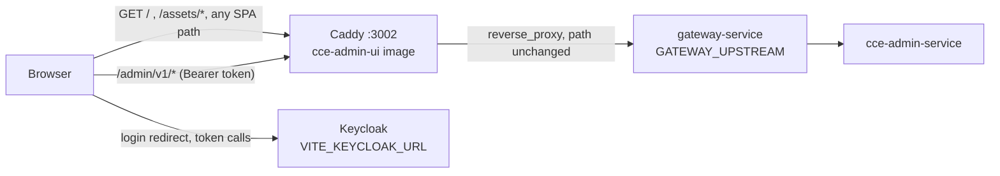

# Deployment guide

The console ships as one Docker image. Caddy serves the static build on port 3002 and
reverse-proxies `/admin/v1/*` to `gateway-service`. The gateway checks the caller's permissions
and forwards to `cce-admin-service`. Keycloak is not served by this image.



## Dockerfile stages

[`Dockerfile`](../Dockerfile):

| Stage           | Base                  | What it does                                                                                                                                                                                                                             |
| --------------- | --------------------- | ---------------------------------------------------------------------------------------------------------------------------------------------------------------------------------------------------------------------------------------- |
| `build`         | `node:20.20.2-alpine` | `npm ci --ignore-scripts`, copies the source (minus [`.dockerignore`](../.dockerignore): `node_modules`, `dist`, `coverage`, `.env*`, test output, `e2e/.auth`, `.git`), sets the four `VITE_*` build args as env, runs `npm run build`. |
| `verify`        | from `build`          | `npm run lint && npm run test:ci`, then fails if `dist/` contains `mockServiceWorker` or `setupServer`. Built only with `--target verify`.                                                                                               |
| final (unnamed) | `caddy:2.11.9-alpine` | Copies `dist/` to `/srv` and the `Caddyfile` to `/etc/caddy/Caddyfile`, exposes 3002. The command exits with "GATEWAY_UPSTREAM is required" if that variable is empty, otherwise runs Caddy.                                             |

`.env` files are not copied into the build context. Every `VITE_*` value must come from a
build argument.

### Build arguments

| Arg                       | Default        | Notes                                                                                                                                                                 |
| ------------------------- | -------------- | --------------------------------------------------------------------------------------------------------------------------------------------------------------------- |
| `VITE_KEYCLOAK_REALM`     | none           | Required. The build fails without it ([`vite.config.ts`](../vite.config.ts)).                                                                                         |
| `VITE_KEYCLOAK_URL`       | `""`           | Empty means `${window.location.origin}/auth` at runtime (see "Origin rule" below).                                                                                    |
| `VITE_KEYCLOAK_CLIENT_ID` | `cce-admin-ui` |                                                                                                                                                                       |
| `VITE_API_BASE_URL`       | `""`           | Keep it empty for this image. The CSP only allows `connect-src 'self'` plus `KEYCLOAK_ORIGIN`, so an API on another origin would be blocked. It would also need CORS. |

```sh
# Production image
docker build --build-arg VITE_KEYCLOAK_REALM=<realm> \
             --build-arg VITE_KEYCLOAK_URL=https://<keycloak-host>/auth \
             -t cce-admin-ui .

# The image check (lint, tests with coverage thresholds, no mock code in the bundle)
docker build --target verify --build-arg VITE_KEYCLOAK_REALM=<realm> .
```

Because the values are compiled into the bundle, you need one image per environment, unless
the environments share the same realm, client and Keycloak URL. There is no runtime config file
for the SPA.

## The image check (`--target verify`)

The `verify` stage runs on the reference Node 20 image. It is the CI gate for the console:

1. `npm run lint`: ESLint, including the import rules, and `prettier --check`.
2. `npm run test:ci`: all Vitest tests, with coverage thresholds (80 % lines, statements and
   functions; 70 % branches).
3. `! grep -rqE 'mockServiceWorker|setupServer' dist`: proves that no MSW code reached the
   production bundle.

It does not run the Playwright tests. Those need the live local stack.

## Caddyfile

[`Caddyfile`](../Caddyfile), site address `:3002`. It serves plain HTTP; TLS must end in front
of it.

| Part                                                              | Behaviour                                                                                                                                                                                                                                                                                 |
| ----------------------------------------------------------------- | ----------------------------------------------------------------------------------------------------------------------------------------------------------------------------------------------------------------------------------------------------------------------------------------- |
| Compression                                                       | `encode zstd gzip`                                                                                                                                                                                                                                                                        |
| Security headers (every response, proxied API responses included) | `X-Frame-Options: SAMEORIGIN`, `X-Content-Type-Options: nosniff`, `Referrer-Policy: strict-origin-when-cross-origin`, `Content-Security-Policy: default-src 'self'; script-src 'self'; connect-src 'self' {$KEYCLOAK_ORIGIN}; frame-ancestors 'none'; object-src 'none'; base-uri 'none'` |
| `/admin/v1/*`                                                     | `reverse_proxy {$GATEWAY_UPSTREAM}`, path unchanged                                                                                                                                                                                                                                       |
| Everything else                                                   | `root /srv`; `try_files {path} /index.html` (SPA fallback, so deep links like `/roles/<id>?tab=permissions` work); `file_server`                                                                                                                                                          |
| `/assets/*`                                                       | `Cache-Control: public, max-age=31536000, immutable` (Vite's hashed file names)                                                                                                                                                                                                           |

`index.html` gets no explicit cache header, so a new deploy is picked up on the next load.

## Runtime configuration

| Variable           | Required                           | Purpose                                                                                                                                                                                                                                                     |
| ------------------ | ---------------------------------- | ----------------------------------------------------------------------------------------------------------------------------------------------------------------------------------------------------------------------------------------------------------- |
| `GATEWAY_UPSTREAM` | yes                                | Address of `gateway-service`, for example `http://gateway-service:<port>`. Point it at the gateway, never directly at the admin service; the gateway enforces per-role API permissions.                                                                     |
| `KEYCLOAK_ORIGIN`  | when Keycloak is on another origin | Added to CSP `connect-src`, so `keycloak-js` can call the token endpoint. Use the origin only (scheme, host, port), for example `https://sso.example.org`. Without it, sign-in is blocked when the image was built with a cross-origin `VITE_KEYCLOAK_URL`. |

```sh
docker run -e GATEWAY_UPSTREAM=http://gateway-service:<port> \
           -e KEYCLOAK_ORIGIN=https://<keycloak-host> \
           -p 3002:3002 cce-admin-ui
```

**Origin rule.** The console is served at `/`. Either the console's origin also routes `/auth`
to Keycloak (then leave `VITE_KEYCLOAK_URL` empty and `KEYCLOAK_ORIGIN` unset), or build with
`VITE_KEYCLOAK_URL` and run with `KEYCLOAK_ORIGIN`. Caddy in this image does not route `/auth`.
Without an `/auth` route, the login redirect to the default URL is answered with the
console's own `index.html`, so sign-in cannot complete.

The image has no health-check instruction. `GET /` returns `index.html` (200) and can serve as
a liveness check.

## Keycloak client the console needs

One public OpenID Connect client per realm. The local realm import
([`../../cce-admin-service/keycloak/realm-cce.json`](../../cce-admin-service/keycloak/realm-cce.json))
is the reference for these settings:

| Setting                            | Value                                                                                                                      |
| ---------------------------------- | -------------------------------------------------------------------------------------------------------------------------- |
| Client id                          | `cce-admin-ui` (or the value of `VITE_KEYCLOAK_CLIENT_ID`)                                                                 |
| Client authentication              | off (public client, no secret)                                                                                             |
| Standard flow (Authorization Code) | on. Implicit flow, direct access grants and service accounts are off.                                                      |
| PKCE                               | `pkce.code.challenge.method` = `S256` (the console always sends S256)                                                      |
| Valid redirect URIs                | `https://<console-origin>/*` (locally `http://localhost:3002/*`). Keycloak returns the browser to the URL first requested. |
| Valid post-logout redirect URIs    | `https://<console-origin>/*`. Sign out redirects to `<origin>/`.                                                           |
| Web origins                        | `https://<console-origin>`, for CORS on the token endpoint                                                                 |
| Audience mapper                    | `oidc-audience-mapper` adding `gateway-service` to the access token. The service rejects tokens without this audience.     |
| Default client scopes              | `basic`, `profile`, `email`, `roles`, `web-origins`, `acr`                                                                 |

The console does not use the login iframe (`checkLoginIframe: false`) or silent SSO. It keeps
the token in memory. Every 60 s it refreshes the token if less than 70 s remain. With an access
token lifespan of 70 s or less, it refreshes on every tick. A token that expires between ticks
is caught by the client's refresh on 401.

Signing in to Keycloak is not enough to use the console. The service also needs an active local
user for the token's `sub`; otherwise every call returns 403 `FORBIDDEN`. The gateway's
`api_permissions` rows also decide which `/admin/v1` calls the user's roles may make. A refused
call shows "You do not have permission to do this." inline.

## Things to check before a deploy

- `VITE_KEYCLOAK_REALM` is set as a build arg. `VITE_KEYCLOAK_URL` and `KEYCLOAK_ORIGIN` match
  the origin rule.
- `GATEWAY_UPSTREAM` points at the gateway, and the gateway routes `/admin/**` to the admin
  service.
- The Keycloak client has the console's redirect URI, post-logout URI, web origin and the
  `gateway-service` audience mapper.
- `docker build --target verify` passes for the same commit.

## Worth knowing

- `X-Frame-Options: SAMEORIGIN` and CSP `frame-ancestors 'none'` disagree. Browsers that support
  CSP use `frame-ancestors`, so the console cannot be framed at all.
- The `/assets/*` cache header is set before `try_files`. A request for a missing asset (for
  example an old hash after a redeploy) gets `index.html` with a one-year immutable cache header.
  The code does not handle this case.
- The security headers are also added to the proxied `/admin/v1` responses.
